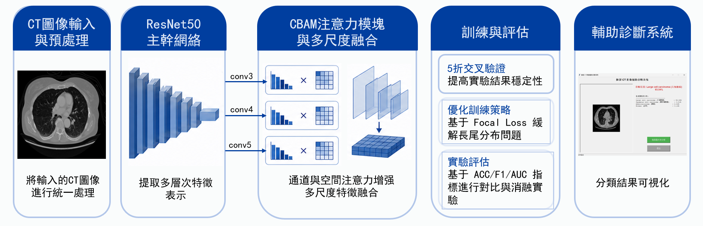
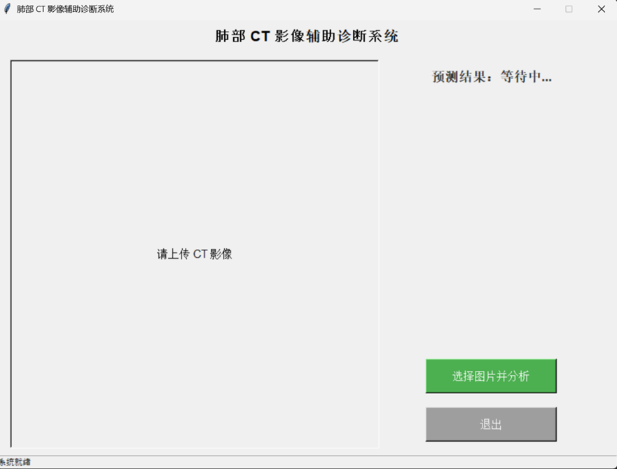
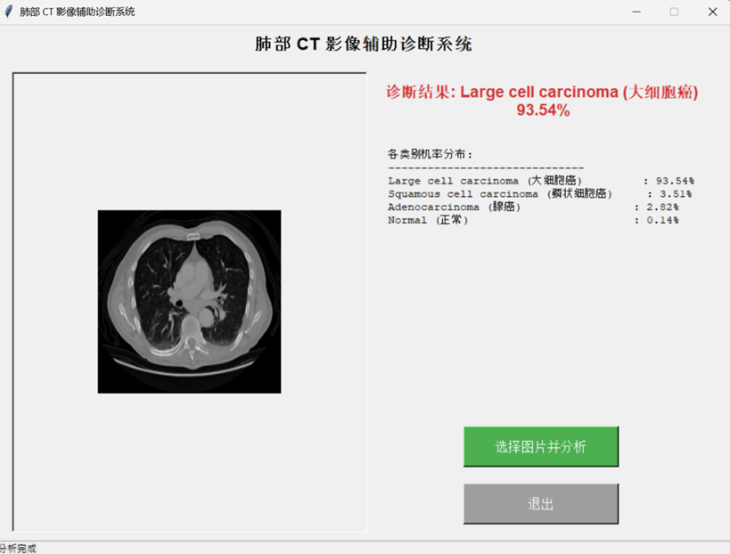
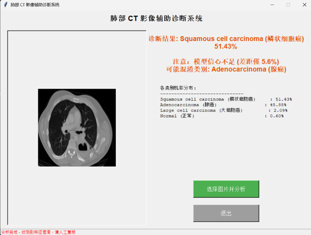

**系統架構圖：**

**專案亮點：**
* 運用 PyTorch 開發用於肺部 CT 影像分類（4 個類別）的端到端深度學習流程。
* 從 ResNet50 提取多尺度特徵（conv3/conv4/conv5），並整合 CBAM 注意力模組。
* 採用焦點損失（Focal Loss）解決類別不平衡問題。透過 5 折交叉驗證、消融實驗及基準模型比較進行驗證。
* 在測試集上達到 98% 的準確率。

**系統展示影片：**

  <iframe width="700" height="400" src="https://www.youtube.com/embed/nNBa6-tl34k" frameborder="0" allow="accelerometer; autoplay; clipboard-write; encrypted-media; gyroscope; picture-in-picture" allowfullscreen></iframe>

**使用者介面與預測結果：**
<figure class="third">
  
  
  
  <figcaption>點擊圖片可放大查看系統細節</figcaption>
</figure>

* 實作 Tkinter 使用者介面，用於互動式推論與機率視覺化。
