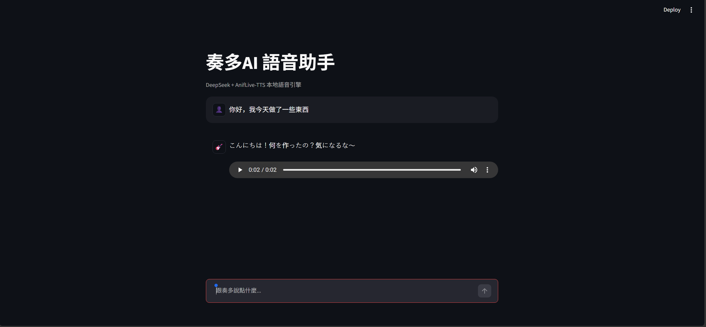

**使用者介面與示範：**

*此互動式使用者介面展示了透過 DeepSeek + TTS 管道生成的跨語言對話（示範為中文輸入、日語語音輸出）。*

**專案概述：**
透過整合 DeepSeek 大型語言模型與高效能的開源 TTS 執行環境，開發出端到端的語音聊天 AI 系統。該系統可實現逼真且低延遲的語音對話。

**關鍵工程貢獻：**
*   **系統整合**：建置完整的處理流程，其中使用者輸入的文字會透過 **DeepSeek API** 進行處理以產生自然語言回應，隨後再透過 TTS 引擎將其合成語音。
*   **模型部署與疑難排解**：成功處理預訓練模型權重的轉換，並解決環境依賴性衝突，使上游的 TTS 執行環境得以正常運作。
*   **開源合規**：在將我的整合腳本開源前，已對敏感的 API 金鑰進行匿名處理，並正確標註上游開源授權資訊。

**上游 TTS 引擎：** [Hiruynk 開發的 AnifLive-TTS](https://github.com/Hiruynk/AnifLive-TTS) *(註：該引擎為開源專案；我的工作重點在於 API 整合與處理流程部署。)*
